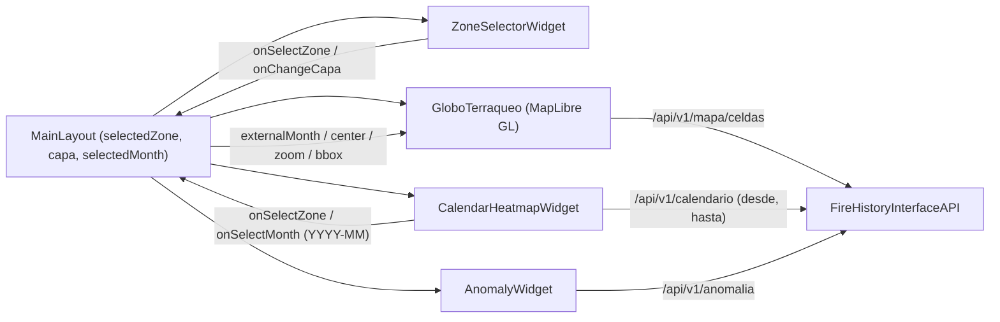

# Registro Técnico y Arquitectónico de Cambios (MapLibre, Navegación Histórica, Calendario y Esquemática)

Este documento consolida todos los cambios realizados en `FireHistoryInterface` durante el ciclo reciente de trabajo, organizados en una cadena de ramas aisladas menores a 400 líneas (`*-denis-pablo`). Resume la arquitectura resultante, los elementos añadidos, eliminados y modificados, y las justificaciones técnicas, estéticas y funcionales de cada decisión.

---

## Resumen Ejecutivo de la Cadena de Ramas

| Orden | Rama | Commit | Alcance principal | Impacto |
|---|---|---|---|---|
| 1 | `feat/maplibre-globe-denis-pablo` | `cd1afee` | Migración de Mapbox GL JS a MapLibre GL JS + IGN Argenmap Oscuro | 11 archivos (`+342 / -201`) |
| 2 | `feat/globe-date-nav-denis-pablo` | `8740ef9` | Navegación histórica mensual y filtrado territorial en vivo | 3 archivos (`+207 / -20`) |
| 3 | `feat/globe-polish-denis-pablo` | `2eff496` → `d3b2fcd` | Vista 3D inclinada, selector satelital Esri, timeline lineal, Google Maps, auto-timelapse y fix `optimizeDeps` | 5 archivos (`+371 / -62` sobre rama 2) |
| 4 | `feat/calendar-filters-denis-pablo` | `af9726c` | Filtros modernos de período, selector de zona en calendario y sincronización con mapa | 4 archivos (`+331 / -14`) |
| 5 | `feat/satellite-auto-explode-denis-pablo` | `b62e4d2` | Desarme automático acelerado y marco compacto de tarjetas alrededor del satélite | 2 archivos (`+121 / -18`) |

> [!NOTE]
> Además, en el repositorio hermano `FireHistoryInterfaceAPI` (rama `propuesta-denis-pablo`), se generó el análisis estadístico `docs/10-paper-armonizacion-backend.md` sin modificar el código productivo del backend ni agregar endpoints fuera de contrato.

---

## Arquitectura Resultante y Flujo de Estado

El layout principal ([MainLayout.tsx](../src/app/layout/MainLayout.tsx)) coordina la selección territorial (`selectedZone`), el canal satelital (`capa`) y el período puntual (`selectedMonth`) entre el selector maestro, el mapa WebGL y la grilla histórica:

### Decisiones Arquitectónicas Clave
1. **Sincronización bidireccional controlada sin duplicar fuentes**: `MainLayout` mantiene `selectedZone` y `selectedMonth` como estado compartido; seleccionar una provincia o un mes desde `CalendarHeatmapWidget` actualiza automáticamente `GloboTerraqueo` (`externalMonth`), pausando el timelapse para inspeccionar ese período exacto.
2. **Aislamiento en ramas encadenadas `< 400` líneas**: cada unidad funcional (migración WebGL, datos históricos, pulido de interacción, calendario interactivo, esquemática satelital) vive en su propia rama con tests y build validados.
3. **Observación de deuda estructural**: `MainLayout.tsx` monta dos árboles responsivos ocultos por CSS (`hidden lg:grid` y `lg:hidden`), duplicando instancias WebGL de `GloboTerraqueo`. Se documenta como mejora futura unificar el render en un único contenedor responsivo.

---

## Detalle de Cambios por Módulo

### 1. Motor Cartográfico y Experiencia del Mapa (`GloboTerraqueo.tsx`, `vite.config.ts`, `index.css`)

| Acción | Elemento | Justificación Técnica | Justificación Estética y Funcional |
|---|---|---|---|
| **Eliminado** | Dependencia `mapbox-gl`, token `VITE_MAPBOX_ACCESS_TOKEN`, pantalla de ingreso de token | Elimina bloqueo por credenciales externas y simplifica despliegue/testing | El usuario accede de inmediato a los focos sin configurar API keys |
| **Eliminado** | Rotación orbital continua en modo IGN (`bearing` + `setInterval` redundante) | `setInterval` competía con `moveend` y `flyTo` provocaba cancelaciones | En mapa nacional plano/inclinado girar la cámara desorientaba; sin globo real no aportaba valor |
| **Eliminado** | Clases `animate-ping` agresivas y estado `'...'` colapsable en el badge de carga | Evita reflujo de layout (`layout shift`) cada cambio de mes | Mantiene ancho fijo (`min-w-[148px] tabular-nums`) con transición suave de opacidad |
| **Añadido** | `maplibre-gl` + capa TMS **IGN Argenmap Oscuro** sin API key | Tiles públicos con soporte CORS (`EPSG:3857`) y control total de pintura raster | Estética científica oscura coherente con el diseño del tablero |
| **Añadido** | Alternancia dinámica a **Esri World Imagery** (`SATELLITE_GLOBE_STYLE`) con `projection: 'globe'` | `map.setStyle` permite cambiar entre mapa base local y cobertura planetaria | Resuelve el vacío oscuro fuera de Argentina cuando se desea vista satelital global |
| **Añadido** | Auto-timelapse al cargar (`2200ms`), deslizador `<input type="range">` lineal y `.hotspot-appear` escalonado | Respeto a `prefers-reduced-motion`; `delayMs` acotado a `1100ms` por mes | Permite ver la evolución histórica pintándose progresivamente sin saltos bruscos |
| **Añadido** | Enlace directo a Google Maps en popups (`https://www.google.com/maps?q=lat,lng`) | Coordenadas exactas formateadas a 4 decimales en `Popup.setHTML` | Facilita verificar geográficamente cualquier foco en un clic |
| **Añadido** | Nivelado automático al hacer clic en el mapa (`pitch: 0`, `bearing: 0`) | Detecta clic fuera de `.hotspot-marker`, frena animaciones (`map.stop()`) | Permite navegar, arrastrar y hacer zoom sin resistencia tras la vista inclinada inicial |
| **Modificado** | `vite.config.ts`: `optimizeDeps: { exclude: ['maplibre-gl'] }` | Evita el error de pre-bundling de Vite con `maplibre-gl-worker.mjs` | Garantiza HMR estable en servidor de desarrollo |

### 2. Grilla Histórica y Filtros (`CalendarHeatmapWidget.tsx`, `MainLayout.tsx`)

| Acción | Elemento | Justificación Técnica | Justificación Estética y Funcional |
|---|---|---|---|
| **Eliminado** | Grilla rígida `min-w-[580px]` en proporción `7/5` y `<input type="month">` nativo | Evita desbordamiento horizontal y quita el selector nativo heterogéneo del SO | Alinea el estilo oscuro moderno y evita que la matriz se comprima |
| **Añadido** | Presets rápidos (`Todo`, `10y`, `5y`, `2026`), rango `Desde → Hasta` y selector puntual Mes/Año | Envía `desde` y `hasta` reales al endpoint `/api/v1/calendario` | Selección temporal intuitiva sin popups nativos anticuados |
| **Añadido** | Selector de zona (`PROVINCIAS_ARG`) dentro del calendario y clic en cada celda | Reutiliza `PROVINCIAS_ARG` y propaga `onSelectZone` / `onSelectMonth` | Permite filtrar provincia y saltar a un mes exacto en el mapa con un clic |
| **Modificado** | Proporción desktop de `7/5` a `6/6` (`lg:col-span-6`) y grilla fluida `minmax(0,1fr)` | Ajusta la distribución CSS Grid sin duplicar lógica | Da aire visual a las 12 columnas mensuales + `Total` anual |

### 3. Esquemática Satelital (`SatelliteSchematic.tsx`)

| Acción | Elemento | Justificación Técnica | Justificación Estética y Funcional |
|---|---|---|---|
| **Modificado** | Secuencia automática de desarmado (`600ms` inicial, ciclo cada `2400ms`) | Usa timers limpiados al desmontar y se pausa ante `prefers-reduced-motion` o interacción | Evita obligar al usuario a pulsar un botón para ver los subsistemas desplegados |
| **Modificado** | Contenedor central reducido (`lg:col-span-6`, `h-[280px]`–`340px`) rodeado por tarjetas | Reorganiza `SUBSYSTEMS` en marco `3 izquierda + centro + 3 derecha + 1 base` | El diagrama actúa como pieza decorativa equilibrada en lugar de ocupar ancho completo excesivo |

---

## Contratos Backend Verificados

- **`/api/v1/anomalia`**: en `FireHistoryInterfaceAPI/app/services/anomalia.py`, cuando no hay años históricos (`n == 0`), el backend retorna `null` en `mediana`, `p25`, `p75` y `percentil`. En `src/api/types.ts`, `AnomaliaResponse` los tipa como `number`; `MainLayout.tsx` protege `mediana`, `p25` y `p75` con `?? 0`.
- **`/api/v1/calendario`**: consume `provincia_id` / `bbox`, `capa`, `desde` y `hasta`, alineado con `CalendarioParams` en `src/api/client.ts`.
- **`/api/v1/mapa/celdas`**: consume `bbox`, `desde`, `hasta`, `capa` y `min_focos`.

---

## Verificación de Calidad

- [x] `npm run typecheck` (`tsc --noEmit`): 0 errores.
- [x] `npm test` (`vitest run`): 9 archivos / 38 tests aprobados (`GloboTerraqueo.test.tsx`, `CalendarHeatmapWidget.test.tsx`, `SatelliteSchematic.test.tsx`, `App.test.tsx`, `Satellite.test.tsx`, `SatelliteModal.test.tsx`, `Footer.test.tsx`, `BackendHealthIndicator.test.tsx`, `useDialogA11y.test.tsx`).
- [x] `npm run build` (`tsc -b && vite build`): compilación de producción sin errores.
